<!--
  ✨ Samartha Padwekar — GitHub README
  Built with curiosity, consistency, and a serious amount of coffee.
-->

<div align="center">



<a href="https://git.io/typing-svg">
  
</a>

<br/>


</div>

---

## 🧑‍💻 About Me

Hey there! I'm **Samartha Padwekar**, a **B.E. Computer Science & Engineering** student who enjoys turning ideas into clean, functional software. I'm driven by curiosity, powered by consistency, and always up for a good problem to solve.

```ts
const samartha = {
  education: "B.E. Computer Science & Engineering",
  role: "Student • Developer • Lifelong Learner",
  focus: ["Data Structures & Algorithms", "Full-Stack Development", "Open Source"],
  currentlyLearning: ["System Design", "AI & Machine Learning"],
  lookingFor: ["Internships", "Collaborations", "Open-Source Projects"],
  motto: "Learn. Build. Share. Repeat.",
};
```

- 🔭 Currently building projects that challenge me to think bigger
- 🌱 Sharpening my DSA skills one problem at a time
- 🤝 Open to collaborating on student-friendly open-source projects
- ⚡ Fun fact: I believe every bug is just a feature waiting for a better story

---

## 🎯 Goals & Focus

| 🎯 Goal | 🧭 What I'm doing about it |
| :--- | :--- |
| **Master DSA** | Solving problems consistently and learning to think in patterns, not just answers. |
| **Ship real products** | Building and deploying full-stack projects that solve real problems. |
| **Contribute to open source** | Learning in public and giving back to the tools and communities I use. |
| **Land a great internship** | Sharpening fundamentals, building a strong portfolio, and staying interview-ready. |
| **Explore AI/ML** | Understanding the technology shaping the next decade — one project at a time. |

---

## 🛠️ Tech Stack

<div align="center">

**Languages**


**Frontend**


**Backend & Databases**


**Tools & Platforms**


</div>

---

## 📊 GitHub Analytics

<div align="center">

<picture>
  <source media="(prefers-color-scheme: dark)" srcset="https://github-readme-stats.vercel.app/api?username=Samartha1604&amp;show_icons=true&amp;rank_icon=github&amp;hide_border=true&amp;bg_color=0D1117&amp;title_color=8B5CF6&amp;icon_color=22D3EE&amp;text_color=C9D1D9" />
  <source media="(prefers-color-scheme: light)" srcset="https://github-readme-stats.vercel.app/api?username=Samartha1604&amp;show_icons=true&amp;rank_icon=github&amp;hide_border=true&amp;bg_color=FFFFFF&amp;title_color=7C3AED&amp;icon_color=0891B2&amp;text_color=334155" />
  
</picture>

<picture>
  <source media="(prefers-color-scheme: dark)" srcset="https://streak-stats.demolab.com?user=Samartha1604&amp;hide_border=true&amp;background=0D1117&amp;ring=8B5CF6&amp;fire=22D3EE&amp;currStreakLabel=8B5CF6&amp;sideLabels=C9D1D9&amp;currStreakNum=F8FAFC&amp;sideNums=F8FAFC&amp;dates=64748B" />
  <source media="(prefers-color-scheme: light)" srcset="https://streak-stats.demolab.com?user=Samartha1604&amp;hide_border=true&amp;background=FFFFFF&amp;ring=7C3AED&amp;fire=0891B2&amp;currStreakLabel=7C3AED&amp;sideLabels=334155&amp;currStreakNum=0F172A&amp;sideNums=0F172A&amp;dates=64748B" />
  
</picture>

</div>

---

## 📈 Contribution Activity

<div align="center">


<br/>

<picture>
  <source media="(prefers-color-scheme: dark)" srcset="https://github-profile-summary-cards.vercel.app/api/cards/profile-details?username=Samartha1604&amp;theme=github_dark" />
  <source media="(prefers-color-scheme: light)" srcset="https://github-profile-summary-cards.vercel.app/api/cards/profile-details?username=Samartha1604&amp;theme=default" />
  
</picture>

</div>

---

## 🐍 Contribution Snake

<div align="center">

<picture>
  <source media="(prefers-color-scheme: dark)" srcset="https://raw.githubusercontent.com/Samartha1604/Samartha/output/github-contribution-grid-snake-dark.svg" />
  <source media="(prefers-color-scheme: light)" srcset="https://raw.githubusercontent.com/Samartha1604/Samartha/output/github-contribution-grid-snake.svg" />
  
</picture>

</div>

---

## 🤝 Let's Connect

I'm always happy to meet fellow builders, learn from mentors, and collaborate on ideas worth shipping.

<div align="center">

[](https://github.com/Samartha1604)
[](mailto:padwekarsamartha@gmail.com)

</div>

---

<div align="center">

### 💭 A line I code by

> "First, solve the problem. Then, write the code."
>
> — **John Johnson**


</div>
